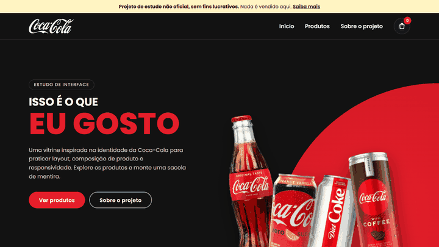

<p align="center">
  <a href="https://will-ifes.github.io/Website_modern/">
    
  </a>
</p>

# Estudo de loja virtual · inspirado na Coca-Cola

Vitrine de e-commerce construída como exercício de HTML, CSS e JavaScript, a partir de um estudo de layout com a identidade visual da Coca-Cola. Revisada para ser responsiva, acessível e com cara de loja real, sem vender nada.

**HTML · CSS · JavaScript** · [Ver online](https://will-ifes.github.io/Website_modern/)

> [!IMPORTANT]
> **Projeto de estudo não oficial e sem fins lucrativos.** Não tem vínculo, patrocínio ou autorização da The Coca-Cola Company. Coca-Cola, Diet Coke, os logotipos e as imagens dos produtos pertencem aos seus donos e aparecem só como referência de estudo. Os preços são ilustrativos, nada é vendido e nenhum dado é coletado. Se algum titular de direitos preferir, o conteúdo será removido.

<p align="center">
  <a href="https://will-ifes.github.io/Website_modern/">
    
  </a>
  <br />
  <sub>Clique na demonstração para abrir a página publicada.</sub>
</p>

## O que mudou na revisão

| Antes | Depois |
| --- | --- |
| Só funcionava em 1920×1080; no celular as latas cobriam o texto e o menu sumia | Layout em grid com breakpoints em 1024px, 860px e 480px e menu com botão no celular |
| Uma única tela de hero | Vitrine com cabeçalho fixo, grade de produtos, sacola e seção sobre o projeto |
| Nenhuma menção ao caráter de estudo | Faixa de aviso fixa no topo, seção "Sobre este projeto", rodapé e `noindex` |
| 4 PNGs de ~300 KB cada | WebP de 32 a 47 KB, com transparência mantida |
| Fonte Poppins com `@import` quebrado (nunca carregava) | Poppins via `<link>` com `preconnect` |
| Lorem ipsum em inglês e links para `#` | Texto em português e âncoras para seções reais |
| Ícones sociais com `alt="icons"` | Ícones removidos e imagens com `alt` descritivo |
| Sem `h1` e sem foco visível | Hierarquia de títulos, foco destacado e link "Pular para o conteúdo" |

### Sacola de demonstração

- Fica só em memória e some ao recarregar a página. Nada é salvo nem enviado.
- O contador do cabeçalho é anunciado ao leitor de tela, e cada produto adicionado mostra um aviso flutuante (`role="status"`) lembrando que a página não vende.
- O botão "Finalizar compra" fica desativado, com a explicação ligada por `aria-describedby`.
- Esc fecha a sacola e o menu e devolve o foco ao botão.

**Validação:** axe-core sem violações, com a sacola e o menu abertos, e sem rolagem horizontal em 375px, 768px e 1366px.

## Por dentro do código

| Arquivo | Responsabilidade |
| --- | --- |
| [`index.html`](index.html) | Estrutura da vitrine, avisos e dados dos produtos (`data-nome`, `data-preco`). |
| [`styles.css`](styles.css) | Tokens, hero com `clip-path`, grade de produtos e breakpoints. |
| [`script.js`](script.js) | Menu do celular, sacola em memória e avisos. |

## Executar localmente

Não há dependências nem build. Com Python 3:

```bash
git clone https://github.com/Will-Ifes/Website_modern.git
cd Website_modern
python -m http.server 8080
```

Abra http://localhost:8080.

---

Mantido por **Will Oliveira** · [Perfil](https://github.com/Will-Ifes) · [LinkedIn](https://www.linkedin.com/in/wildemberg-de-jesus-oliveira/)
